# AEFS Notes

**AI Engineering from Scratch** 的个人学习仓库：先跟着 Jupyter 章节跑练习，学完再为每课出一张中文备忘卡。


## 卡片长这样

|                                                     |                                                              |                                                                   |
| --------------------------------------------------- | ------------------------------------------------------------ | ----------------------------------------------------------------- |
| 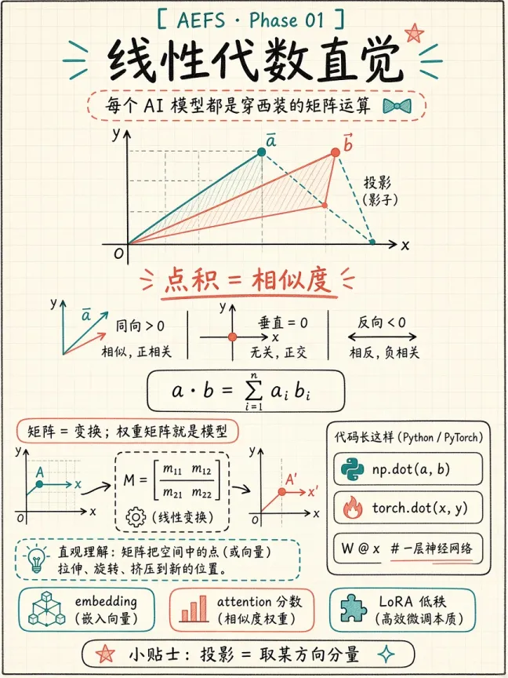 线性代数直觉   | 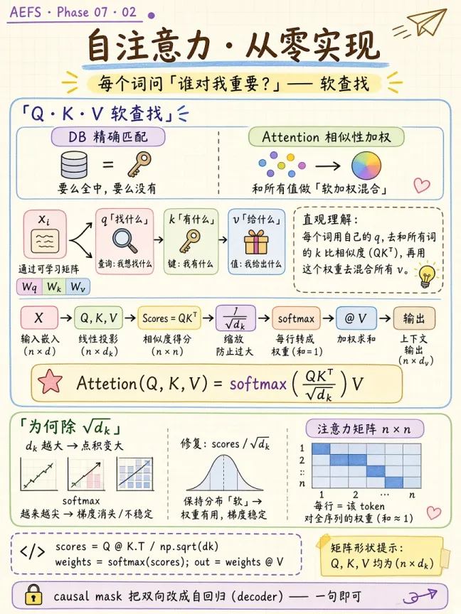 自注意力从零实现          | 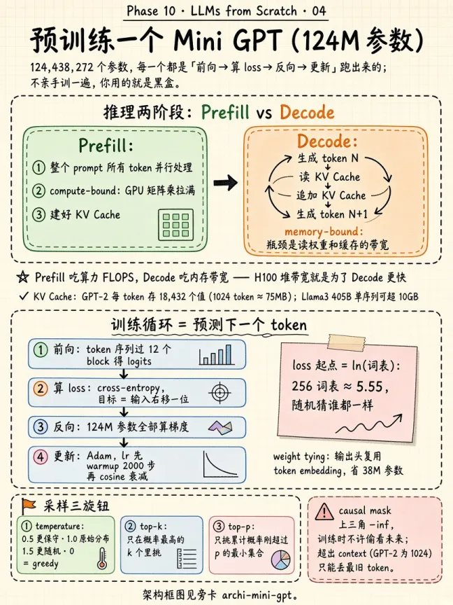 预训练 mini-GPT    |
| 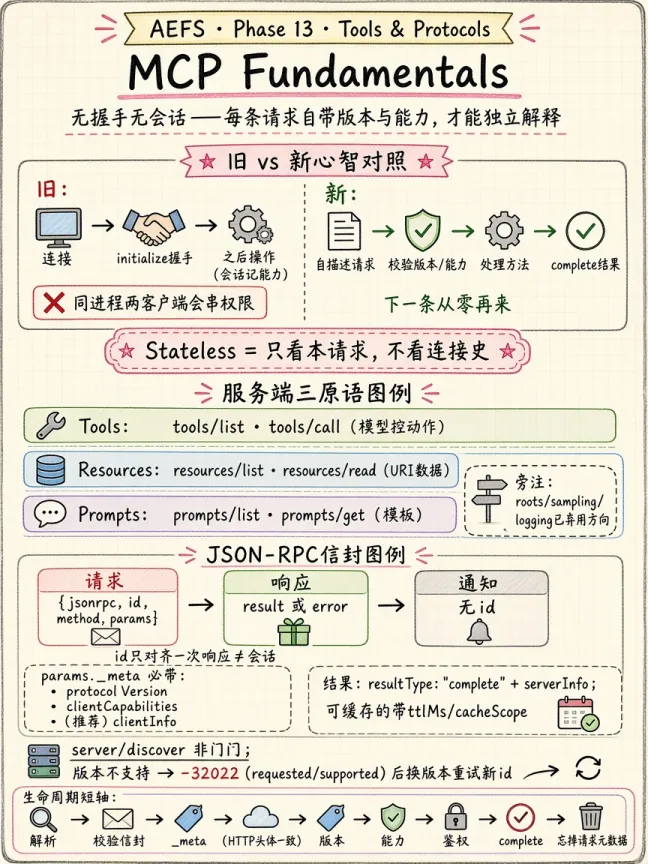 MCP 基础 | 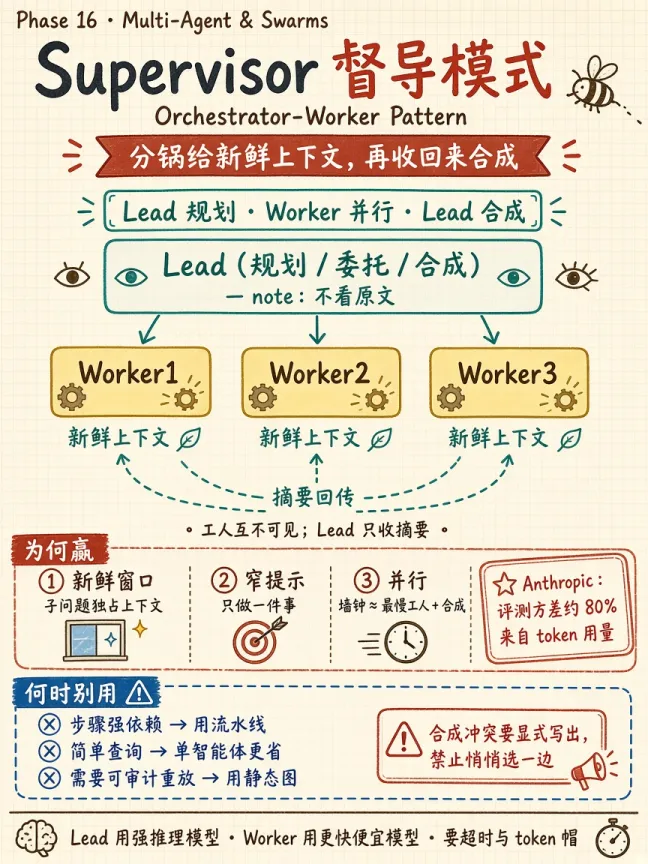 Supervisor 编排 | 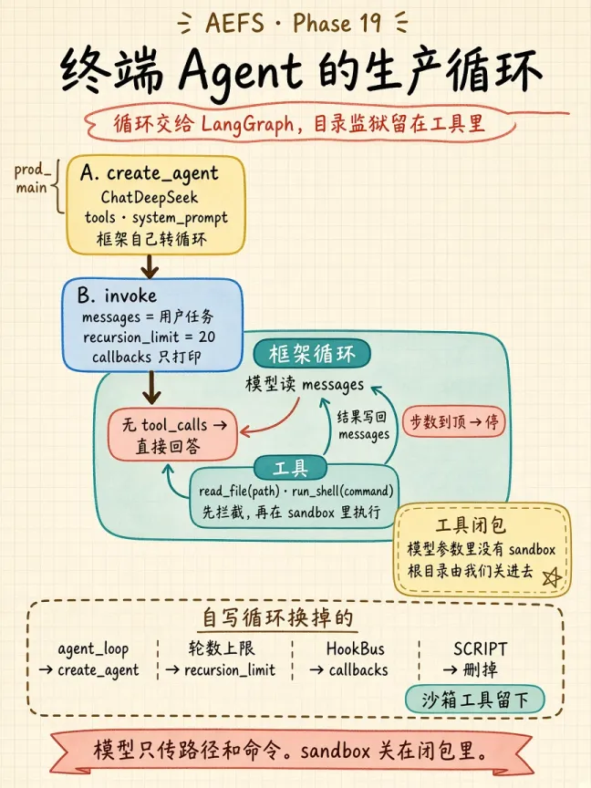 终端 Coding Agent |

每张卡把一课的要点压成一页：定义 → 直觉 → 公式/代码 → 考点。这里是缩略图，原图见 `notes/cards/`。

## Jupyter 视图

`notes/jupyter_books/` 里有 222 个 notebook。下面都是从里面直接跑出来的输出，点图进原 notebook：

|                                                    |                                                   |                                                         |
| -------------------------------------------------- | ------------------------------------------------- | ------------------------------------------------------- |
| [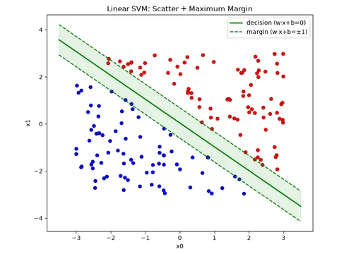](notes/jupyter_books/03_Machine_Learning/05_SVM/code.ipynb) 03 · SVM 决策边界      | [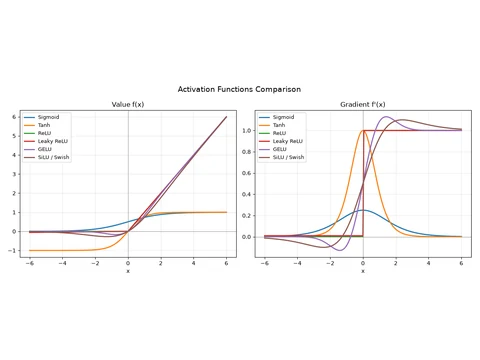](notes/jupyter_books/04_Deep_Learning/04_Activation_Functions/code.ipynb) 04 · 激活函数 | [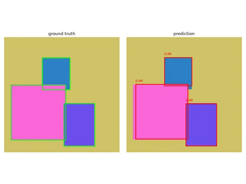](notes/jupyter_books/05_Computer_Vision/06_Object_Detection/code.ipynb) 05 · 目标检测  |
| [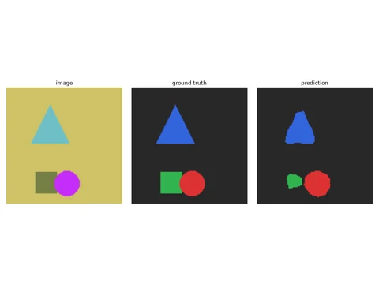](notes/jupyter_books/05_Computer_Vision/07_Semantic_Segmentation/code.ipynb) 05 · 语义分割 | [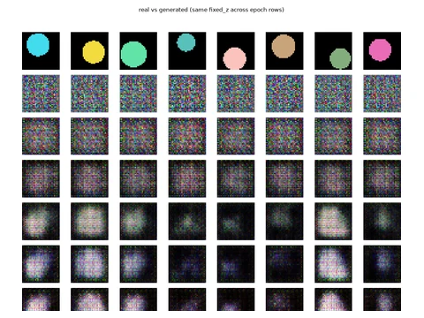](notes/jupyter_books/05_Computer_Vision/09_GANs/code.ipynb) 05 · GAN 生成样本    | [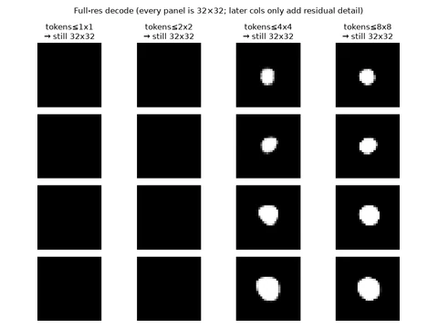](notes/jupyter_books/09_Genrative_AI/15_Visual_AutoRegressive/code.ipynb) 09 · 自回归图像生成 |

## 其他

### 桌面挂件

`deskpet/` 是只 macOS 桌面挂件：趴在桌面上翻 `notes/cards/` 的卡片，划词选一个缩写让它用 DeepSeek 展开解释，也可以输入一句话检索备忘卡。

|                                                                    |                                                                 |                                                                       |
| ------------------------------------------------------------------ | --------------------------------------------------------------- | --------------------------------------------------------------------- |
|  悬停 → 翻一张 notes/cards 的卡片 |  划词 → DeepSeek 展开解释 | 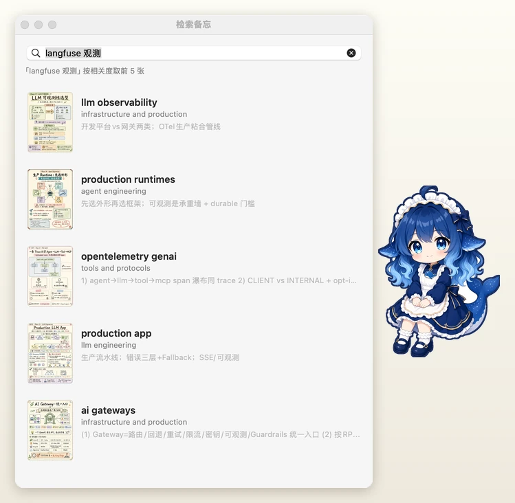 检索 → 缩略图 + 标题，单击放大 |

### 卡片检索

检索走三路按名次融合（RRF），因为卡片正文在 PNG 里、文字抽不出来：

- **视觉**：colSmol-500M 的 late-interaction，MaxSim——query 每个 token 对全卡 patch 取 max 再求和，角落里的一行小字也能单独被咬中。
- **文本**：目录名 + 出卡时写下的 `heroes_declared` + 课文导语，中文按二元组切词走 BM25，专名（Langfuse / p99 / A2A）靠这一路。
- **语义**：同一份 `heroes` 走 bge-small-zh，补「幻觉 vs 缓解≠证明」这种词面完全不同的说法。

三路原始分量纲不可比，且与相关性反向（「唐诗三百首」的视觉分反而高过「langfuse 观测」），所以门禁不卡在融合分上：语义与 BM25 各设一条原始分下限，两路都过才出结果。实测 12 条合法 + 8 条无关，合法全留、无关漏进 2/8——而卡融合分是 5/8。返回的仍是按融合分排序的前 `TOP_K` 张，排第一不等于相关，它只是这次相对最高的一张。

索引落盘 `.cache/cards_visual.pt`，按 PNG 的 mtime 增量更新（新增一张只编那一张）。

```bash
python notes/rag_retrieve.py --index        # 首次建索引，506 张约 37 分钟（CPU 4.2s/张）
python notes/rag_retrieve.py "评测怎么做"    # 命令行检索
python notes/rag_retrieve.py --eval         # 用已知答案的 query 量召回
```
