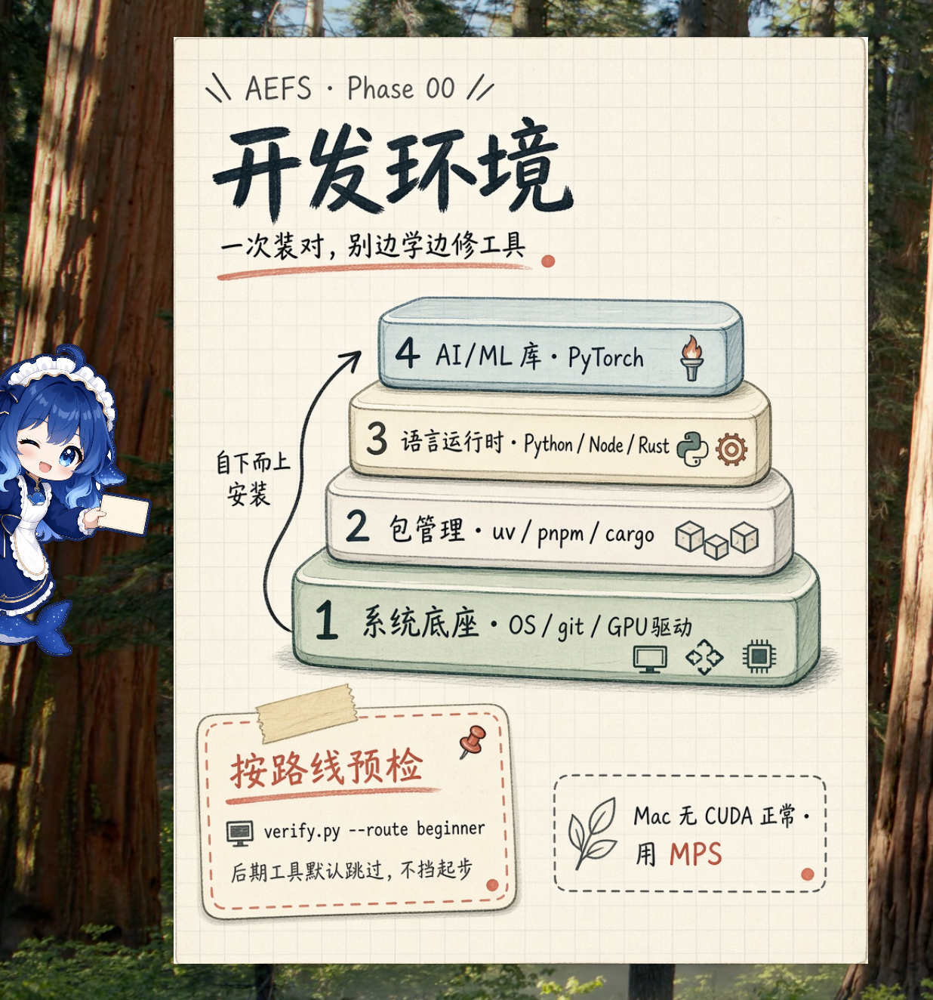

# AEFS Notes



AEFS（AI Engineering from Scratch）课程的个人学习仓库：每课一张中文备忘卡，配套 Jupyter 章节和可运行的练习代码。

## 里面有什么

| 目录 | 内容 |
|------|------|
| `notes/cards/` | 510 课的中文备忘卡（PNG），按 20 个 phase 分目录 |
| `notes/progress.md` | 出卡进度表：日期、课程、卡片路径、评分、尝试次数 |
| `notes/jupyter_books/` | 按 phase 整理的 Jupyter 章节 |
| `codes/` | 练习代码：27 个 Python 标准库模块、LangChain、LangGraph、PyTorch、Docker、并发专题、MCP |
| `codes/summary/` | 33 份按主题分组的 API 速查页（HTML） |
| `codes/capstone/` | 5 个 capstone 项目 |
| `deskpet/` | 桌面挂件：翻卡片，用 DeepSeek 解释缩写 |

## 三个入口

- **看卡片** — 先查 `notes/progress.md` 定位课程，再进 `notes/cards/<phase>/<lesson>/`
- **查 API** — 打开 `codes/index.html` 导航页，点进 `codes/summary/*.html`
- **跑练习** — 每个主题按章节分目录，核心是 `qa.ipynb`

## 卡片是怎么来的

由 `.cursor/skills/aefs-lesson-memo` 生成：按模板出图 → 用 rubric（`evaluator.md`）打分 → 不达标就重试，结果写回 `notes/progress.md`。当前 501 课通过，8 课重试到上限（`exhaust`）。

## 使用

仓库带 git 子模块（若干 Cursor skill），克隆时记得递归：

```bash
git clone --recursive <repo-url>
```

## 说明

课程内容与题目版权归 AEFS 上游，本仓库只放个人笔记、卡片和练习代码。
